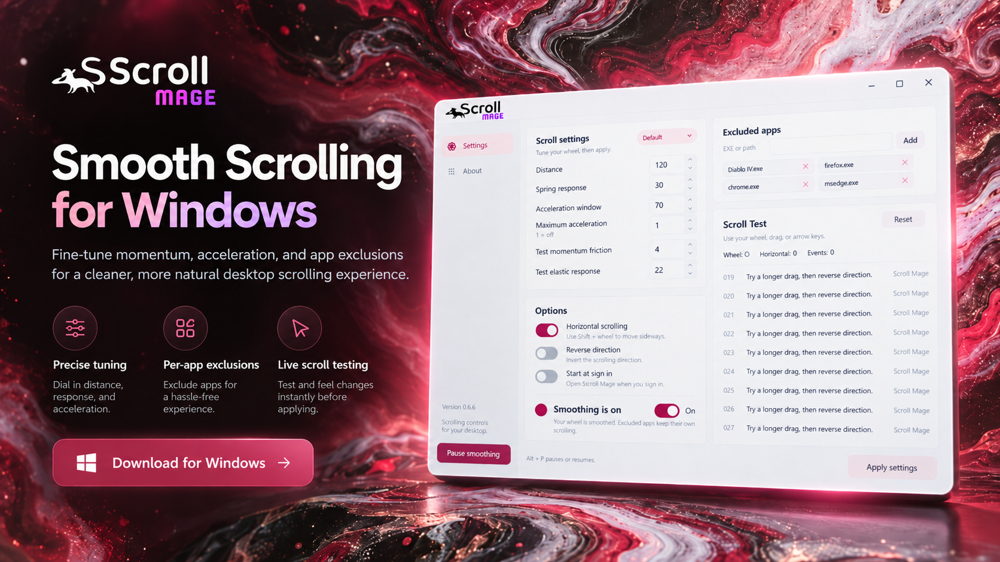

# Scroll Mage



**A scrolling extension for Windows that makes mouse wheel scrolling feel more natural, consistent, and customizable.**

I built Scroll Mage because I wanted smoother scrolling on Windows with settings I could actually dial in. Pick a preset, adjust the feel, and leave specific apps alone when their scrolling already works for you.

It lives in the tray, stays out of your way, and gives you a quick way to pause whenever you need it.

Scroll Mage is for desktop mice and does not support touchpads. Precision touchpads send fine-grained scrolling, which Scroll Mage leaves to Windows. Some older touchpad drivers imitate a notched mouse wheel instead; Windows does not tell Scroll Mage which device sent those events, so they may be smoothed like a mouse. Press **Alt + P** to pause if that happens.

## What it does

- Smooths regular mouse wheel input in supported Windows apps.
- Lets you adjust scroll distance, response, and acceleration.
- Includes **Default**, **macOS style**, and **Super smooth** presets.
- Supports horizontal scrolling with **Shift + mouse wheel** and an optional reverse direction.
- Lets you exclude individual apps by their EXE name or full path.
- Gives you a built-in **Scroll Test** area for wheel input, dragging, and arrow keys.
- Can start when you sign in to Windows, if you enable that option.

## Get it running

1. Open **Scroll Mage** from the desktop shortcut or run `ScrollMage.exe`.
2. Choose **Default** for crisp, precise scrolling, **macOS style** for a softer accelerated response, or **Super smooth** for fast free-spin-style coasting. Selecting a preset saves and activates it immediately.
3. Choose **Custom** to tune it yourself: the Scroll settings card opens to show every value. Click **Apply changes** to save your edits. Custom remembers its values when you switch to another preset and back.
4. Try the result in **Scroll Test**, then in the apps you use.
5. If an app feels better with its own scrolling, add it to **Excluded apps**.

For exclusions, enter something like `game.exe` or paste the full EXE path, then click **Add** or press **Enter**. Adding or removing an exclusion saves it immediately. Other tuning changes and the sign-in option use **Apply settings**.

Use `Start Paused.lnk` when you want to open the app with smoothing paused. Normal launches start with smoothing enabled unless a startup problem prevents it.

## Keep control of it

| Action | What happens |
| --- | --- |
| **Alt + P** | Pause or resume smoothing. |
| **Pause smoothing / Enable smoothing** | Change the current smoothing state from the app. |
| **Close the window** | Keep Scroll Mage running in the tray. |
| **Open the app again** | Bring the existing window back. |
| **Quit from the tray menu** | Exit Scroll Mage completely. |

Run one scrolling utility at a time so they do not compete for the same input.

## Dial in the feel

**Distance** controls the scroll amount per wheel notch. **Response** controls how quickly each scroll eases to a stop: every notch starts at full speed and slows smoothly, and a higher response finishes sooner. **Acceleration window** and **Maximum acceleration** control how repeated wheel input builds speed. A maximum acceleration of **1** turns acceleration off.

The **macOS style** preset is inspired by that feel: a soft, longer ease-out, with strong acceleration so slow notches stay precise while a fast spin travels several times further. It is Scroll Mage's own tuning, not Apple's scrolling engine.

**Super smooth** emulates free-spin in software: a quick flick (rapid same-direction notches, or one packet containing several notches) starts a fast coast that gradually slows. Slow individual notches keep their normal distance. Reverse the wheel, click the left, middle, or right mouse button, pause, or change targets to stop the coast. Software cannot remove the physical detents of your wheel or detect your finger touching it. Its coast is independent of the test-friction control.

**Test momentum friction** and **Test elastic response** affect dragging inside Scroll Test. They do not add momentum or elastic edges to every Windows app. Each app still controls how it displays incoming scrolling, so the result can vary.

Browsers are smoothed like any other app. Apps that scroll in whole lines, such as File Explorer and many older Windows programs, collect small wheel movements into line-sized steps, so they look less smooth than browsers, Office or code editors.

## Local and straightforward

Scroll Mage runs locally. Your settings stay in `settings.json` beside the executable, so keep the app in a folder you can write to. There is no account, activation system, telemetry, or built-in updater, and the app contains no networking code.

To smooth scrolling, Scroll Mage reads mouse wheel events through a Windows low-level mouse hook and sends smoothed wheel events in their place. It runs without administrator rights and leaves apps that run as administrator alone. [SECURITY.md](SECURITY.md) describes exactly what it touches.

The app is built for 64-bit Windows. Download **0.7.0** from [GitHub Releases](https://github.com/Frozt-src/ScrollMage/releases/tag/v0.7.0). Builds are not code-signed yet, so Windows SmartScreen may warn on first run; check your download against the SHA-256 checksum published with the release. See the [changelog](CHANGELOG.md) for changes and compatibility notes.

Version 0.7.0 replaces the scrolling engine, adds a **Custom** preset, retunes the other presets and smooths browsers by default. See the [production audit](source/docs/PRODUCTION-AUDIT-2026-10-21.md) and the [mouse acceptance checklist](source/docs/MOUSE-ACCEPTANCE-0.7.0.md) for test evidence, hands-on checks and rollback steps.

## Known limitations

- Touchpads are not supported, by design. Mouse wheels in a high-resolution mode that sends less than one notch at a time pass through unsmoothed.
- The interface uses a fixed light theme and does not yet follow Windows High Contrast.
- Each app decides how it draws incoming scrolling, so results vary between apps.

## Build from source

You need 64-bit Windows, Rust (the version is pinned in `rust-toolchain.toml`), the Microsoft C++ build tools and a Windows SDK.

```powershell
./tools/Validate.ps1
```

```powershell
./tools/Package.ps1
```

The first command checks formatting, lints and runs the tests. The second builds a portable ZIP under `dist/`. [BUILD.md](BUILD.md) covers manual builds and release checks.

## Contributing

Bug reports and pull requests are welcome. Start with [CONTRIBUTING.md](CONTRIBUTING.md), and report security problems privately as described in [SECURITY.md](SECURITY.md).

## License

Scroll Mage's code is open source under the [MIT License](LICENSE). Its artwork is licensed under [CC BY 4.0](LICENSE-ARTWORK.md).

[THIRD_PARTY_NOTICES.md](THIRD_PARTY_NOTICES.md) lists the licenses and notices that apply to bundled third-party components.
